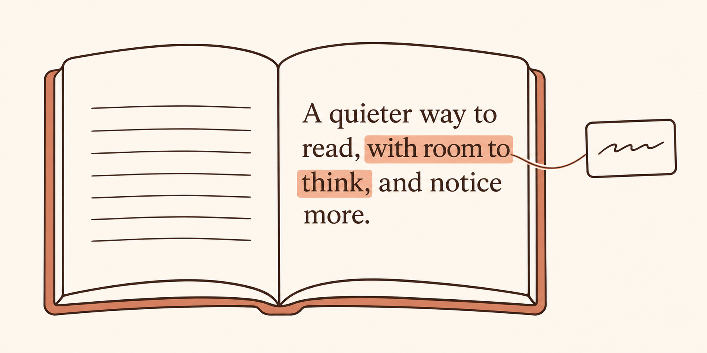

<div align="center">

# Margin

**Read something. Say what it made you think. Find that thought again when it matters.**



A voice-first reading workspace with a clean article reader, handwritten-style margin notes, and an AI companion that explains passages and connects ideas across your reading.

</div>

## What you can do

- **Read without the page clutter.** Paste a public article link to extract and read its main content. Use the section rail, reading progress, and resume control to move through long articles.
- **Think out loud.** Select a passage and hold **Space** or the microphone control to dictate a thought. Live transcription appears as you speak; save or edit the note beside the passage.
- **Ask Margin.** Ask a question about the current passage or search your library. Answers stream with citations that link back to their source passages. Follow-up questions keep the discussion going.
- **Reconnect ideas.** Semantic and keyword search look across indexed article passages and saved thoughts to surface related material.

## Stack

| Area               | Technology                                     |
| ------------------ | ---------------------------------------------- |
| Web                | React, TypeScript, Vite, Bun                   |
| API                | FastAPI, Python 3.13                           |
| Storage            | PostgreSQL with pgvector                       |
| Article extraction | Scrapling and Trafilatura                      |
| Speech and AI      | NVIDIA hosted speech, embedding, and chat APIs |
| Code quality       | Oxlint, Prettier, Ruff, ty                     |

## Run locally

### Requirements

- Bun 1.2.16 or newer
- Python 3.13 and [uv](https://docs.astral.sh/uv/)
- Docker Desktop or Docker Engine with Compose
- An NVIDIA API key with access to the configured speech, embedding, and chat models

### Start locally

```sh
cp .env.example .env
bun install
uv sync --directory api
docker compose up -d db
bun run dev
```

This runs the web app and API on your machine and PostgreSQL in Docker. Open <http://localhost:5173>. The API runs at <http://127.0.0.1:8000>; its health check is <http://127.0.0.1:8000/health> and interactive API docs are at <http://127.0.0.1:8000/docs>.

To run all three services in Docker instead, use `docker compose up --build` or `bun run dev:docker`. Use `bun run dev:logs` to follow container logs and `bun run dev:down` to stop the Docker stack. Host ports can be changed with `WEB_PORT`, `API_PORT`, and `POSTGRES_PORT` in `.env`.

Add your NVIDIA API key in **Settings** in the app. The key is sent with requests that need NVIDIA and is not stored by the API. Article reading and extraction can be tried without enabling companion features.

Stop PostgreSQL while preserving its data with:

```sh
bun run db:down
```

## Data and privacy

Article library, notes, speech preferences, and reading positions are stored in browser `localStorage`. The API uses a browser-generated `clientId` to associate notes, article passages, and companion conversations in PostgreSQL. This is a prototype identity mechanism, not account authentication; it does not provide secure multi-user access or cross-device sync.

When you use NVIDIA-powered features, Margin sends the relevant audio, question, article passages, or note text to NVIDIA for transcription, embeddings, or answer generation. API keys are passed per request and are not written to the app database. Companion conversations are stored in PostgreSQL and the browser so they can be reopened in this installation.

## Development checks

```sh
bun run lint
bun run format:check
bun run typecheck
bun run check
```

Run backend tests:

```sh
uv run --directory api python -m unittest discover -s tests -v
```

Run PostgreSQL integration tests after starting the database:

```sh
RUN_POSTGRES_INTEGRATION=1 uv run --directory api python -m unittest discover -s tests -v
```

## Performance and answer quality

The project includes reproducible scripts for live latency, voice, and grounding checks. Set `NVIDIA_API_KEY` in the shell before running them. The quality evaluation also uses the configured chat model as a judge; inspect its examples because model-based grading is not ground truth.

```sh
uv run --directory api python benchmarks/companion.py
uv run --directory api python benchmarks/voice.py
uv run --directory api python benchmarks/grounding_eval.py
```

See [the companion guide](docs/companion.md) for endpoint behavior and benchmark details, and [the measured performance report](docs/performance-report.md) for the small live sample results and their limitations. Benchmark figures are development measurements, not production service guarantees.

## Repository layout

```text
api/       FastAPI app, article extraction, memory, companion, tests, benchmarks
web/       React application
docs/      Companion guide and performance report
```

## License

See [LICENSE](LICENSE).
